  

# Hi there!

### 💻 IT Student | Aspiring Full-Stack Developer

## 👨‍💻 About Me

- 🎓 Studying Information Technology at HUIT
- 🚀 Interested in Full-Stack Development and AI
- 💡 Passionate about building real-world applications
- 📍 Based in Ho Chi Minh City, Vietnam

## 🛠️ Languages and Tools

## 🔥 GitHub Streak

---

### Thanks for visiting my profile! ⭐

